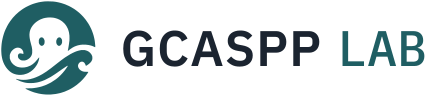

<p align="center">
  
</p>

# GCASPP LAB — Design System

Base visual compartilhada dos sistemas **GCASPP LAB** (g-lab): tokens de cor, tipografia, espaçamento e raio, componentes em CSS puro, ícones e logos. Nasceu do sistema Contratos GCASPP.

## Como usar em um sistema

**1. Inclua o CSS** (fontes + tokens + componentes num só arquivo):

```html
<link rel="stylesheet" href="https://cdn.jsdelivr.net/gh/gcaspp-labs/glab-design-system@v1.0.0/css/glab.css">
```

> O link via jsDelivr só funciona se o repositório for público. Em repositório privado, adicione este repo como submódulo (`git submodule add https://github.com/gcaspp-labs/glab-design-system design-system`) ou como dependência npm (`npm install github:gcaspp-labs/glab-design-system#v1.0.0`) e aponte para `css/glab.css`.

Se preferir só as variáveis, sem os componentes: `tokens/tokens.css`.

**2. Use as classes e variáveis:**

```html
<button class="btn btn-primary">Novo contrato</button>
<span class="pill pill-success">Vigente</span>
<div class="panel"><div class="panel-head"><h2>Faturas</h2></div><div class="panel-body">…</div></div>
```

```css
.meu-card { background: var(--surface); border: 1px solid var(--line); border-radius: var(--radius-12); padding: var(--space-18); }
```

**3. Tema:** o claro é o padrão e o escuro segue o sistema operacional. Para forçar, use `<html data-theme="light">` ou `<html data-theme="dark">`.

**4. Ícones:** `import { icon } from "./icons/icons.js"` → `icon("file")`, ou os SVGs soltos em `icons/svg/`.

**5. Logos:** em `assets/logos/` — veja quando usar cada um em [assets/logos/README.md](assets/logos/README.md).

## Estrutura

| Pasta | Conteúdo |
|---|---|
| `tokens/tokens.json` | Fonte da verdade: cores (claro/escuro), tipografia, espaçamento, raios, sombra, layout |
| `tokens/tokens.css` | Variáveis CSS geradas a partir do JSON |
| `css/glab.css` | Ponto de entrada: `fonts.css` + `tokens.css` + `components.css` |
| `components/<Nome>/` | Diretrizes (`README.md`) e exemplo vivo (`example.html`) de cada componente |
| `icons/` | Conjunto de ícones de traço (JSON, módulo JS e SVGs) |
| `assets/logos/` | Símbolo do polvo, assinatura horizontal e versão g-lab, para fundo claro e escuro |
| `index.html` | Galeria com todos os componentes |

Abra `index.html` no navegador (ou ative o GitHub Pages) para ver a galeria.

## Componentes

- [AmendCard](components/AmendCard/README.md) — Cartão de aditivo contratual na aba Aditivos: tipo + status no topo, metadados em 3 colunas.
- [Button](components/Button/README.md) — Botões de ação da interface: primário, padrão, ghost, pequeno, destrutivo em texto, botão de ícone e link de adicionar linha.
- [Chip](components/Chip/README.md) — Chips de filtro em grupo (`chip-filter`), seleção única; o ativo usa `accent` com texto `on-accent`.
- [DetailGrid](components/DetailGrid/README.md) — Cabeçalho de detalhe (voltar, título `title-detail`, subtítulo, status) e grade chave-valor de 3 colunas (`kv-grid`).
- [Drawer](components/Drawer/README.md) — Painel lateral direito para criar e editar registros sem sair da lista; largura `drawer-width` (até 92vw), sombra `shadow`, véu `overlay`.
- [EmptyState](components/EmptyState/README.md) — Estado vazio dentro de um Panel: ícone de 30px a 50% e uma frase em `ink-faint`.
- [FormField](components/FormField/README.md) — Campos de formulário: `field` (rótulo + controle + dica), `field-row` em duas colunas, `fieldset` tracejado para grupos repetíveis com `repeat-row`, e `check-row`.
- [Icons](components/Icons/README.md) — Conjunto de ícones de traço do Contratos GCASPP: grade 24×24, traço 1,7, pontas e junções arredondadas, `fill="none"`, `stroke="currentColor"`.
- [KpiCard](components/KpiCard/README.md) — Cartão de indicador: rótulo `overline`, valor `kpi-value` em IBM Plex Mono, subtexto `caption`.
- [Note](components/Note/README.md) — Aviso em linha dentro de painéis: ícone `warn` + frase em `warning-ink` sobre `warning-soft`.
- [Panel](components/Panel/README.md) — Contêiner padrão de conteúdo: `surface`, borda `line`, raio `radius-12`, sem sombra.
- [Pill](components/Pill/README.md) — Pill de status de contrato, fatura ou cliente: ponto colorido + palavra.
- [SearchBox](components/SearchBox/README.md) — Campo de busca com ícone de lupa, largura máxima 260px.
- [Sidebar](components/Sidebar/README.md) — Barra lateral escura (`sidebar-bg` nos dois temas) com a marca no topo, menu e rodapé.
- [Table](components/Table/README.md) — Tabela de registros (`table.table`) dentro de um Panel com `pad-0`.
- [Tabs](components/Tabs/README.md) — Abas de seção dentro da tela de detalhe; ativa com sublinhado `accent` de 2px.
- [Tag](components/Tag/README.md) — Tag de categoria (módulo de sistema, tipo de contrato) em `accent-strong` sobre `accent-soft`, raio `radius-6`.
- [Toast](components/Toast/README.md) — Confirmação breve no rodapé central depois de salvar/excluir: ícone `check` em `success` + frase curta no passado.
- [Topbar](components/Topbar/README.md) — Barra superior fixa sobre `paper`: breadcrumb, título `title-page` e ações à direita.

## Alterando os tokens

1. Edite `tokens/tokens.json`.
2. Rode `python3 scripts/build-tokens.py` para regenerar `tokens/tokens.css`.
3. Registre a mudança e crie uma nova tag de versão (`v1.1.0`); os sistemas atualizam quando mudarem a versão que usam.

---

# Brand book

GCASPP LAB (abreviado **g-lab**) faz sistemas de gestão para o setor público: contratos, faturas, clientes (prefeituras, câmaras, autarquias, RPPS) e seus módulos. A interface é sóbria e técnica — uma ferramenta de trabalho diário para quem administra contratos públicos, não uma vitrine. A base visual vem do sistema Contratos GCASPP.

## Nome e marca

- Escreva **GCASPP LAB** em maiúsculas na marca, títulos, barra lateral e documentos formais.
- Use **g-lab** (minúsculas, com hífen) onde o espaço é curto ou o tom é interno: rodapés, favicons, nomes de repositório, assinaturas de e-mail, URLs. Nunca "G-Lab", "GLab" ou "glab" em texto corrido.
- O símbolo é o polvo dentro do disco, em `accent`. O polvo e as ondas são vazados: mostram o fundo por trás, nunca recebem outra cor.
- Fundos claros (`paper`, `surface`): `glab-simbolo.svg`, `gcaspp-lab-horizontal.svg`, `g-lab.svg`.
- Fundos escuros (`sidebar-bg`, tema escuro): `glab-simbolo-escuro.svg`, `gcaspp-lab-horizontal-escuro.svg`, `g-lab-escuro.svg`.
- Monocromático: `glab-simbolo-ink.svg` (impressão P&B, carimbos) e `glab-simbolo-branco.svg` (sobre fotos ou cores sólidas escuras).
- Tamanho mínimo do símbolo: 24px. Área de respiro em volta: metade do diâmetro do disco. Não gire, não contorne, não aplique sombra nem degradê.

## Conteúdo e tom

- Português do Brasil, linguagem administrativa clara. Trate o usuário de forma impessoal ("Registre um aditivo"), sem "você" em excesso e sem emoji.
- Caixa de frase em botões, títulos e menus: "Novo contrato", "Dados gerais", "Autarquias / Módulos".
- Status em uma palavra ou expressão curta com número: "Vigente", "Vence em 12 dias", "Vencido há 3d", "Encerrado".
- Toasts no particípio: "Contrato salvo", "Fatura registrada". Avisos dizem o problema e a próxima ação numa frase.
- Formatos pt-BR sempre: moeda `R$ 12.400,00`, data `02/03/2026`, números de contrato `014/2026`.

## Cor

- A página fica em `paper`; conteúdo em `surface` dentro de Panel; destaques de hover em `surface-2`.
- Texto principal em `ink`, secundário em `ink-soft`. `ink-faint` só para metadados que não precisam ser lidos (fica abaixo de 4,5:1 nos dois temas, herdado da fonte); informação essencial vai em `ink-soft`.
- `accent` é a cor da marca: botão primário, chip ativo, aba ativa, foco. Texto sobre `accent` sempre em `on-accent`, nunca branco fixo (no tema escuro o accent clareia e pede texto escuro).
- Estados: `success` (Vigente, Pago), `warning` (prazo próximo), `danger` (vencido, excluir), cada um com seu `-soft` de fundo. Status sempre leva a palavra, nunca só a cor.
- A barra lateral é escura nos dois temas (`sidebar-bg`, `sidebar-text`).
- Tema claro é o padrão; o escuro redefine os mesmos nomes.

## Tipografia

- Família IBM Plex: `sans` para interface (`body` 14px), `serif` para títulos (`title-page`, `title-detail`, `title-panel`, `title-drawer`, peso 600), `mono` para números (`kpi-value`, `mono-num`, sempre tabular).
- Rótulos de KPI e cabeçalhos de tabela em `overline`/`table-head`: maiúsculas com espaçamento.
- Rótulos de campo em `label` (`ink-soft`); subtextos em `caption` (`ink-faint`).

## Espaço, forma e profundidade

- Conteúdo com padding `space-30` no desktop e `space-16` no celular, largura máxima `content-max`.
- Painéis: padding `space-18`/`space-20`, raio `radius-12`, borda `line` — bordas, não sombras.
- Sombra (`shadow`) só em camadas flutuantes: Drawer e toast.
- Raios pequenos e precisos: `radius-7` em campos, `radius-8` em botões, `radius-pill` em pills e chips.
- Foco de teclado: outline sólido de 2px em `focus`, 2px afastado.
- Movimento mínimo: transições de 150–200ms em drawer, menu e toast; desligadas com `prefers-reduced-motion`.

## Layout de aplicação

- Barra lateral fixa (`sidebar-width`) com a marca, Topbar fixa sobre `paper`, conteúdo central.
- Dashboard abre com uma grade de 4 KpiCards e depois Panels com Table.
- Detalhe: DetailGrid + Tabs ("Dados gerais", "Aditivos", "Faturas"). Criar e editar acontecem no Drawer.
- Abaixo de 760px a barra lateral vira gaveta e os KPIs ficam em uma coluna.

## Iconografia

- Ícones de traço próprios (componente Icons): grade 24, traço 1,7, pontas arredondadas, `currentColor`. Sem emoji, sem ícones preenchidos.
- 17px no menu, 15px em botões, 30px em estados vazios.
